# Architecture & System Design

## 1. Overview

**PitchLens** is a startup screening and intelligence workspace built as a modular monorepo. It accepts startup pitches across multimodal formats (video, audio, PDF decks, plain text, and manual transcripts) and evaluates their commercial and technical viability against an explainable 7-dimension rubric supported by empirical market evidence.

The platform is designed to operate completely offline without requiring a dedicated GPU or live AI API keys for the test suite or baseline demo mode, while seamlessly upgrading to hosted Groq LLMs or local CUDA GPU Faster-Whisper when credentials and hardware become available.

```
┌─────────────────────────────────────────────────────────────┐
│                    React + Vite Frontend                    │
│            (Dashboard, New Pitch, Review, Report)           │
└──────────────────────────────┬──────────────────────────────┘
                               │ HTTP / JSON
                               ▼
┌─────────────────────────────────────────────────────────────┐
│                   Node.js / Express API                     │
│  - Multipart Upload Validation & Storage                    │
│  - SQLite Database (pitches, analyses)                      │
│  - In-Process Background Job State Machine                  │
│  - Idempotent Schema Initialization & Crash Recovery        │
└──────────────────────────────┬──────────────────────────────┘
                               │ HTTP / JSON (Internal Service)
                               ▼
┌─────────────────────────────────────────────────────────────┐
│                  Python / FastAPI AI Service                │
│  - Document Ingestion (pypdf, text normalizer)              │
│  - Media Ingestion (FFmpeg audio extraction, duration)      │
│  - Transcription Abstraction (Groq, Faster-Whisper, Manual) │
│  - Translation Abstraction (Groq LLM, Fallback Normalizer)  │
│  - Viability Evaluation (Deterministic Rubric + Groq LLM)   │
│  - Curated Market Evidence Provider & Provenance Filter     │
└─────────────────────────────────────────────────────────────┘
```

---

## 2. Component Separation & Responsibilities

### 2.1 React Frontend (`frontend/`)
- **Technology Stack**: React 18, Vite, TypeScript, Vanilla CSS design system.
- **Role**: Presentational and interactive UI.
- **Security Boundary**: Communicates *only* with the Node.js API (`http://localhost:4000/api`). Never holds API keys or contacts external model providers directly.
- **Pages**:
  - `DashboardPage`: High-level metrics, active screenings, recent pitches table, instant demo trigger.
  - `NewScreeningPage`: Drag-and-drop file upload, manual transcript editor, metadata inputs (industry, geography), client-side validation.
  - `TranscriptReviewPage`: Asynchronous polling of ingestion stage, live transcript viewer/editor, error diagnostics.
  - `ReportPage`: Overall viability gauge, 7 criteria breakdown cards, evidence citations, identified risks/assumptions/questions, market benchmark provenance, JSON export, and print formatting.
  - `HistoryPage`: Pitch catalog, persistent reports, deletion confirmation.
  - `SettingsHealthPage`: Live status checks for Node, Python, SQLite, FFmpeg, and provider readiness.

### 2.2 Node.js Express API (`backend/api/`)
- **Technology Stack**: Node.js 22, Express, TypeScript, `better-sqlite3`, `multer`.
- **Role**: System orchestration, file storage management, relational persistence, and job scheduling.
- **Storage Strategy**:
  - Stored files kept on disk in `storage/uploads/` with cryptographically random UUID filenames to prevent path traversal.
  - SQLite database in `storage/pitches.db` utilizing Write-Ahead Logging (`WAL`) mode and foreign keys enabled.
- **Job Engine**:
  - In-process background task runner (`jobQueue.ts`) handling asynchronous ingestion and transcription for heavy media jobs without introducing Redis or Celery.
  - Boot-time crash recovery: any jobs interrupted by a server restart are automatically detected and transitioned to `FAILED` with actionable restart messages.

### 2.3 Python FastAPI AI Service (`backend/ai-service/`)
- **Technology Stack**: Python 3.13, FastAPI, Uvicorn, Pydantic v2, `pypdf`, `httpx`.
- **Role**: Domain processing engine:
  - Document parsing (`pypdf` for PDFs, multi-encoding fallback for text).
  - Media extraction (`ffmpeg` audio extraction to 16kHz mono WAV).
  - Modular provider interfaces for transcription, translation, evaluation, and market research.
- **Offline / Hardware Independence**:
  - Operates completely without GPU drivers or network access using the `deterministic` evaluator and `fallback` transcriber.

---

## 3. Data Flow & Lifecycle

```mermaid
sequenceDiagram
    autonumber
    actor User
    participant UI as React Frontend
    participant API as Node.js Express API
    participant DB as SQLite DB
    participant AI as Python AI Service

    User->>UI: Uploads Pitch Media (or pastes text)
    UI->>API: POST /api/pitches (multipart / json)
    API->>API: Validate extension & size limit
    API->>DB: INSERT into pitches (status='QUEUED' or 'TRANSCRIPTION_READY')
    API-->>UI: Returns { pitch: { id, status } }
    
    rect rgb(20, 30, 45)
    Note over API,AI: Asynchronous In-Process Background Task
    API->>DB: UPDATE pitches status='PROCESSING'
    API->>AI: POST /ingest { file_path }
    AI->>AI: Extract audio (FFmpeg) or text (pypdf)
    AI-->>API: IngestResponse { extracted_audio_path / extracted_text }
    
    opt If audio extracted
        API->>AI: POST /transcribe { audio_path }
        AI-->>API: TranscribeResponse { transcript, provider_used }
    end
    API->>DB: UPDATE pitches status='TRANSCRIPTION_READY'
    end

    UI->>API: GET /api/pitches/:id (Polling)
    API-->>UI: Returns pitch with transcript
    User->>UI: Reviews & Edits Transcript, clicks "Analyze"
    UI->>API: POST /api/pitches/:id/analyze
    API->>DB: UPDATE pitches status='ANALYZING'
    API->>AI: POST /evaluate { transcript, startup_name, industry, geography }
    AI->>AI: Calculate 7 criteria scores & search market evidence
    AI-->>API: EvaluationResult (Validated Pydantic JSON)
    API->>DB: INSERT into analyses & UPDATE pitches status='COMPLETED'
    API-->>UI: Returns analysis record
    UI->>User: Displays interactive Assessment Report
```



---

## 4. Database Schema

The database relies on two relational tables with cascading foreign keys:

### `pitches`
| Column | Type | Description |
|---|---|---|
| `id` | TEXT PK | UUID string generated by the server |
| `startup_name` | TEXT | Display name of the startup |
| `target_geography` | TEXT | Target regional market |
| `industry` | TEXT | Sector category |
| `original_filename` | TEXT | Original upload filename |
| `input_type` | TEXT | `VIDEO`, `AUDIO`, `PDF`, `TEXT`, `MANUAL` |
| `mime_type` | TEXT | MIME content type |
| `stored_file_path` | TEXT | Path to file stored on disk |
| `file_size` | INTEGER | File size in bytes |
| `status` | TEXT | `QUEUED`, `PROCESSING`, `TRANSCRIPTION_READY`, `ANALYZING`, `COMPLETED`, `FAILED` |
| `original_transcript`| TEXT | Raw transcribed or pasted narrative |
| `normalized_transcript` | TEXT | Cleaned and user-reviewed transcript |
| `detected_language` | TEXT | Language code (e.g. `en`) |
| `error_message` | TEXT | Diagnostic or actionable error state |
| `created_at` | TEXT | ISO8601 timestamp |
| `updated_at` | TEXT | ISO8601 timestamp |

### `analyses`
| Column | Type | Description |
|---|---|---|
| `id` | TEXT PK | UUID string |
| `pitch_id` | TEXT FK | Foreign key referencing `pitches(id)` |
| `rubric_version` | TEXT | e.g. `1.0.0` |
| `evaluation_provider` | TEXT | `deterministic` or `groq` |
| `evaluation_method` | TEXT | Detailed label of evaluation method used |
| `overall_score` | REAL | Weighted composite score (0–100) |
| `criteria_scores_json` | TEXT | Serialized JSON containing all 7 criteria |
| `strengths_json` | TEXT | Array of core strengths |
| `risks_json` | TEXT | Array of identified risks |
| `assumptions_json` | TEXT | Array of underlying assumptions |
| `missing_information_json` | TEXT | Array of diligence gaps |
| `founder_questions_json` | TEXT | Array of 3–5 founder interview questions |
| `market_evidence_json` | TEXT | Array of matched market benchmark records |
| `confidence_score` | REAL | Model confidence (0.0 to 1.0) |
| `confidence_limitations` | TEXT | Disclaimer and limitation notice |
| `is_demo` | INTEGER | Flag indicating demo/synthetic source (0 or 1) |
| `created_at` | TEXT | ISO8601 timestamp |
